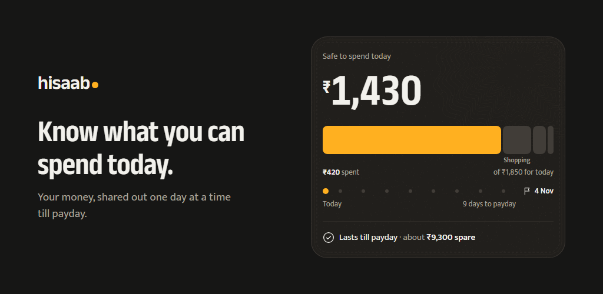
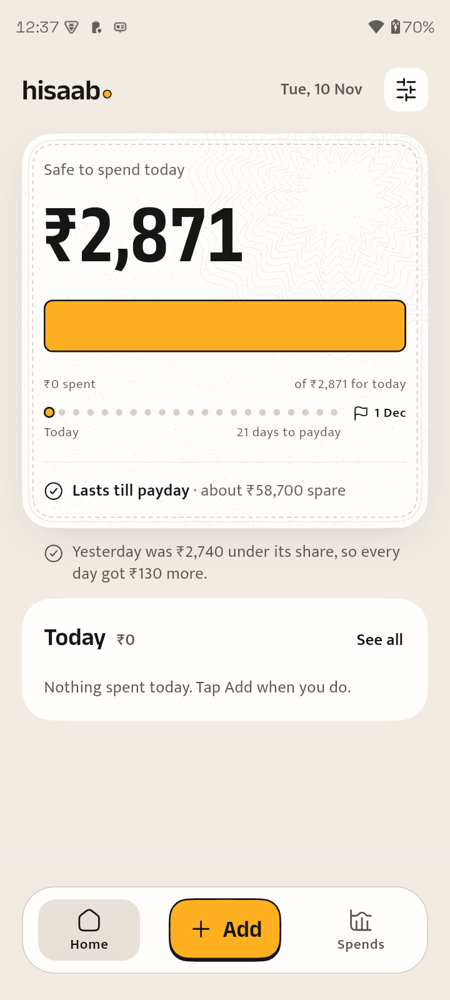
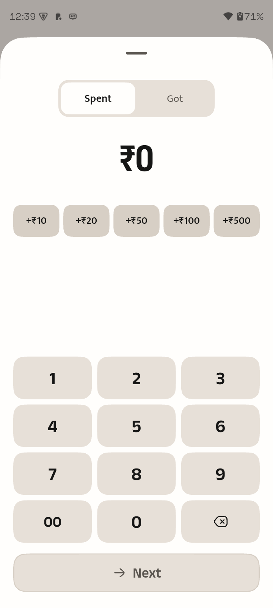
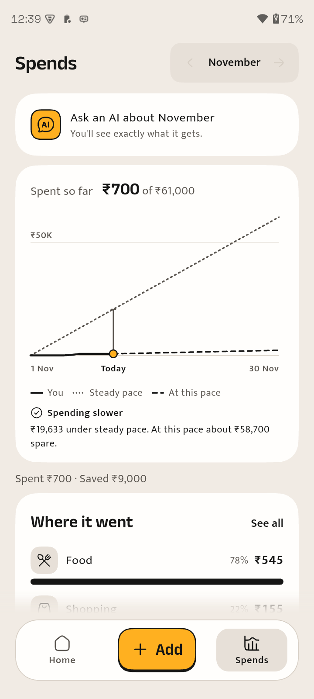
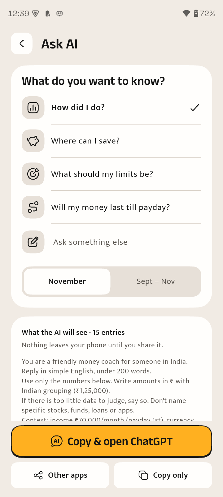
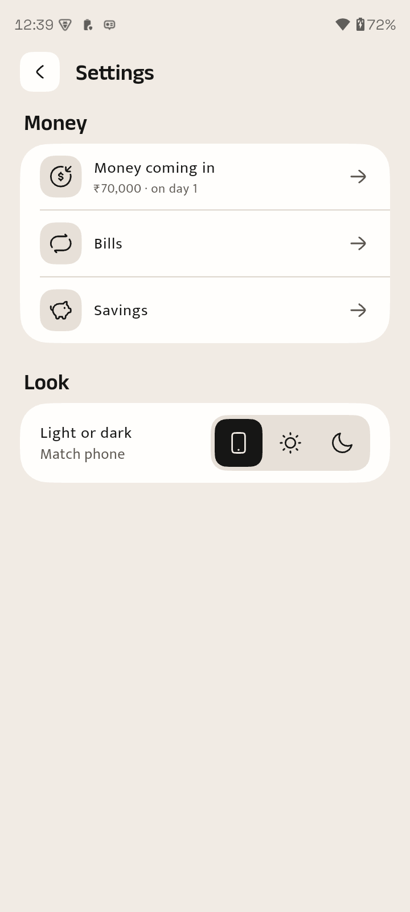

<p align="center">
  
</p>

# hisaab•

**How much can I safely spend today?**

hisaab• is an offline expense tracker and budgeting app for Android, built for Indian users and rupees. Enter your monthly income once. The app splits what's left until payday into a daily share. Every expense takes from today's share, and money you don't spend carries over to the days ahead.

It aims to be simple enough for a 5-year-old to use: no accounts, no bank sync, no charts to learn. Open the app and the number at the top tells you what you can spend today.

## Screenshots

<table>
  <tr>
    <td align="center"><br><b>Home</b></td>
    <td align="center"><br><b>Add</b></td>
    <td align="center"><br><b>Spends</b></td>
    <td align="center"><br><b>Ask AI</b></td>
    <td align="center"><br><b>Settings</b></td>
  </tr>
</table>

## Features

- **Safe to spend today.** One big number on Home, with a bar that drains as you spend and the days left until payday.
- **Fast entry.** Tap Add, type the amount, tap Next, then pick a category. Quick chips add ₹10 to ₹500 in a tap.
- **Spends.** A monthly pace chart compares your spending with a steady pace, and a breakdown shows where your money went.
- **Ask AI.** Pick a question, such as *Will my money last till payday?*, and hisaab• builds a ready-made prompt from your numbers. You can read exactly what the AI will see before you copy it to ChatGPT or share it with any other app.
- **Bills and savings.** Recurring bills and savings are set aside before your daily share is worked out.
- **Light and dark themes,** following your phone or your choice.
- **Backup and restore** to a file you pick.
- **Private.** No internet access, no analytics, no sign-in. Your data stays on your phone. The only thing that leaves it is an Ask AI prompt you choose to share.

## Getting started

Requires Flutter 3.47 (Dart ^3.13) and an Android device or emulator.

```sh
flutter pub get
flutter gen-l10n
flutter run -d <device>
```

Run checks:

```sh
flutter analyze
flutter test
```

## Project docs

| Doc | What it covers |
|---|---|
| [docs/SPEC.md](docs/SPEC.md) | Business rules, screen requirements and edge cases |
| [docs/UI_DESIGN.md](docs/UI_DESIGN.md) | Design spec: tokens, type, screens, motion and copy |
| [docs/PLAN.md](docs/PLAN.md) | Scope, data model, architecture and milestones |
| [docs/DECISIONS.md](docs/DECISIONS.md) | Decision log |
| [docs/design/](docs/design/README.md) | HTML mockups and brand assets |
