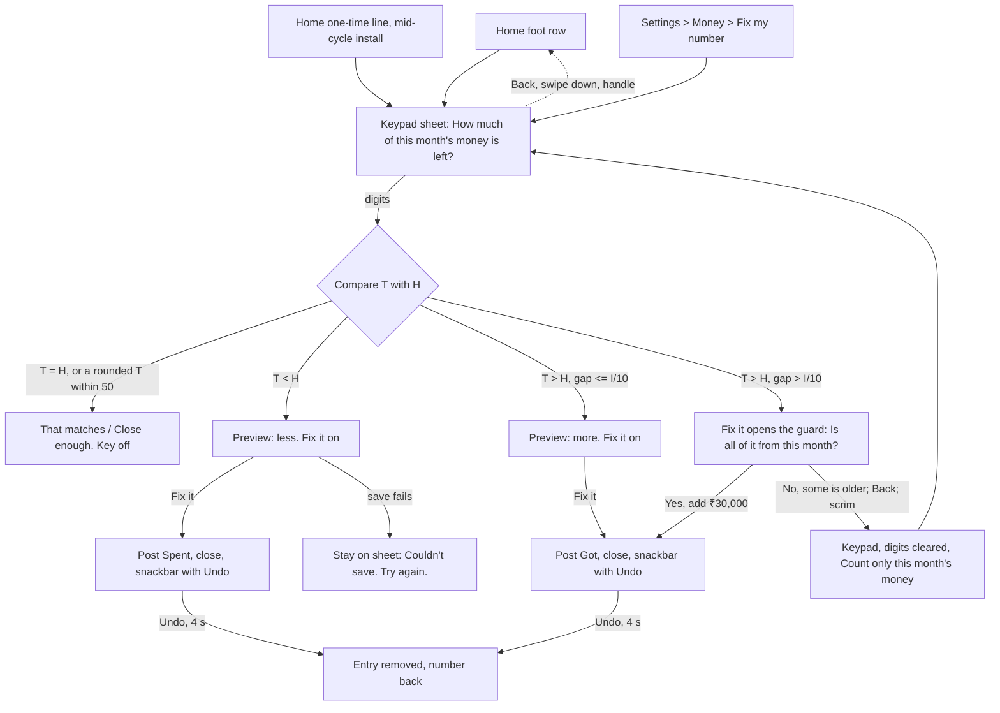

# Fix my number: the comparison rule, entry points and the keypad sheet

> **Status: signed off 2026-11-13 (`08-design-qa-and-signoff.md` §8; resolutions X1 to X47 of §1 applied here).** Nothing here is in SPEC, PLAN, UI_DESIGN or DECISIONS yet, and no code exists; SPEC wins once written. Source: case study 33 §4.1 (P1) and "Owner answers"; case study 34 (research, test plan unrun; the user test does not block the build, 08 §8.3). Binding owner answers: Q6 stays closed (a one-time Home line, no onboarding question); a figure *higher* than hisaab's posts a *Got* "Not logged"; "Not logged" stays visible in Spends and in the Ask AI export; no limit on fixes per day. Copy is the deck's (`docs/design/mockups/41-fix-my-number-copy-deck.md`), styling is for `design-ui`, motion for `design-motion`. Accounting, edge cases, issues and spec edits are in `02-accounting-and-edge-cases.md`. **Symbol note (X34):** the expected-money figure is `H` ("held") and the typed figure is `T`; BR-7's `E` (days elapsed) and BR-8's `X` keep their meaning.

## 1. The crux: what hisaab compares against, and what it asks

### 1.1 The problem
"How much money do you have right now?" asks for **all** the user's money. BR-3's pool counts only this cycle's *Got* entries. So the answer includes money hisaab never counted: a buffer, an emergency fund, last month's leftover, and (day 1 of a cycle) all of last cycle's leftover. The *higher* branch would post a *Got* for it and inflate the hero. Case study 34 §C also warned that `K` includes `Sv_before` (savings that may already have left the account), so subtracting `K` from the answer can double count.

### 1.2 The rule (chosen)
**Ask about this month's money only, compare it with what hisaab expects the user still holds of this cycle's money (`H`), and put a second question in front of any large *higher* figure.**

```
H = remaining + B + R
  = I − (S_prev + R_t + S_today)  −  (Sv_before + Sv_rule_today + Sv_extra_today)
```
`H` is this cycle's income less everything already spent and already saved out. It **keeps** the money earmarked for bills and savings still to come (`B`, `R`), because that money is still in the account. It **drops** `Sv_before` and today's saves, because a *Saved* entry says the money has left. So `H` is the figure a user can honestly read off their accounts for "this month's money", with no subtraction by them. The app then does the sums:

```
gap = H − T              T = the figure the user typed (whole rupees)
gap > 0  -> post Spent gap  (money is missing)      new remaining = T − B − R
gap < 0  -> post Got  −gap  (money is extra)        new remaining = T − B − R
```
After either, `H = T`, which is the proof that the comparison is apples to apples. The user is never asked to take out bills or savings; the app does it (Tesler).

**The second question (the guard).** When `gap < 0` and `−gap > I ÷ 10` (O1: 10% of income, nothing to set), nothing is posted yet. The sheet shows the question "That's ₹30,000 more. Is all of it from this month?" with two stacked keys, *No, some is older* first and *Yes, add ₹30,000* second. *No* returns to the keypad with the line "Count only this month's money." over **cleared digits** (X11: "some is older" means the typed total was wrong, so there is nothing to keep, and no hidden "next key replaces" mode). The threshold is the only number in the design that is not derived. It narrows owner answer P1-2 (a higher figure posts a *Got*): the *Got* still posts on *Yes*.

### 1.3 Options weighed

| Option | For | Against | Verdict |
|---|---|---|---|
| **A. Scope the question to this month's money** (+ guard on large *higher*) | No stored state; the common case is a one-line difference from V1; fits the mid-cycle installer ("how much of this month's pay is left?"); the guard catches the rest | The user must leave out older money, and a small buffer (under 10% of `I`) can still slip through | **Chosen** |
| B. Anchor on the first fix (record a starting buffer, then compare deltas) | Handles a buffer exactly | Stores a figure the pool is never computed from (D120: "computed, never stored"); it drifts as soon as the buffer is touched; day 1 of every cycle needs a new anchor; a hidden number the user cannot see or explain (principle 86) | Rejected |
| C. Ask only about spending money ("What can you still spend?") | Leaves out buffers by wording | Makes the user subtract bills and savings in their head, the sum the app exists to do (Tesler); unknown to most people | Rejected |
| D. Cap or guard the *higher* branch only | Cheap | Alone, it leaves the lower branch wrong for buffer users (they type a total and see "higher by ₹25,800" even though they forgot ₹4,200) | Folded into A as the guard |
| E. Skip the *higher* branch | Safest | Contradicts the owner's answer P1-2 | Not allowed |

Why the guard is only on *higher* (O4: no guard on a big *lower* gap either): a *lower* gap makes the hero smaller and shows its cause, and the preview says "₹45,000 less" in words before saving; a wrong *higher* gap makes the hero **bigger than the money**, which is the harmful error. Both stay undoable.

### 1.4 Worked numbers
SPEC example: `I = 45,000`, cycle 4 Oct to 3 Nov, `t` = 26 Oct, `D = 9`, `B = 1,200`, `K = 0`, `S_prev = 27,150`, ₹420 spent today. `P = 16,650`, `A = 1,850`, hero ₹1,430, `remaining = 16,230`, so **`H = 16,230 + 1,200 = 17,430`** (check: `45,000 − 27,150 − 420`). Guard line: `I ÷ 10 = 4,500`.

| Case | User types `T` | `gap` | Posts | `P` | `A` | Hero | `remaining` |
|---|---|---|---|---|---|---|---|
| Before any fix | | | | 16,650 | 1,850 | 1,430 | 16,230 |
| **1. Forgot ₹4,200** (money really left: 13,230) | 13,230 | +4,200 | *Spent* ₹4,200 | 12,450 | `floor(12,450 / 9)` = 1,383 | 1,383 − 420 = **963** | 12,030 (= 13,230 − 1,200) |
| **2. hisaab under-counts ₹1,000** (a gift or refund never logged) | 18,430 | −1,000 | *Got* ₹1,000 | 17,650 | `floor(17,650 / 9)` = 1,961 | 1,961 − 420 = **1,541** | 17,230 (= 18,430 − 1,200) |
| **3. ₹30,000 buffer, types the total** | 47,430 | −30,000 > 4,500 | nothing yet: second question | | | | |
| 3 then *No*, digits cleared, retypes this month's | 17,430 | 0 | nothing | 16,650 | 1,850 | 1,430 | 16,230 |
| 3 then *Yes* (the owner's own buffer is "this month's") | 47,430 | −30,000 | *Got* ₹30,000 | 46,650 | 5,183 | 4,763 | 46,230 |
| 3b. Buffer and also forgot ₹4,200, types this month's only | 13,230 | +4,200 | as case 1 | | | | |
| 3c. Same user types the total (43,230) | 43,230 | −25,800 | second question, then *No*, retype 13,230 = case 1 | | | | |
| Mid-cycle install on 26 Oct, 36,000 already spent, ₹9,000 of the pay left (`S_prev = 0`, `A = 4,866`) | 9,000 | +36,000 | *Spent* ₹36,000 | 43,800 − 36,000 = 7,800 | 866 | 866 | 7,800 |

Previews: case 1 "Each day gets about ₹467 less" (1,850 − 1,383). Case 2 "about ₹111 more" (1,961 − 1,850). The wrong model in case 3 would have made every day ₹3,333 bigger for money the pay never funded; the guard prevents it. A buffer **under** ₹4,500 passes the guard and is posted; the preview still shows its effect, and Undo is the net (accepted, O1).

### 1.5 The question and the helper (working copy; the user test does not block the build, 08 §8.3)
- Title: "How much of this month's money is left?" Helper: "Bank and cash together. Leave out money from before this month." (copy deck R1, R2; study 34's V6, with V2 as the fall-back if the pre-release test says V6 loses). The test script must carry V6 and a card-bill-still-owed probe (deck B3).
- The page **never** says "we'll take out your bills and savings" as a promise about the typed figure: the typed figure is compared with money that still contains the bills' money. After the fix the preview says what the hero becomes.
- The page shows hisaab's own figure only **after** a digit is typed ("hisaab thought ₹17,430."), so the user reads their bank first and is not anchored (principle 87). Amounts on the sheet use full Indian grouping (O17). "hisaab" is lower case at the start of a sentence (O18).

## 2. Flow


Every state has an exit. Keypad step: Back, system back, Escape, the scrim, swipe down and the handle all close with nothing saved and typing dropped. Guard step: system back, Escape, the scrim and Back = *No* (a step back); swipe down and the handle close the whole sheet with nothing posted (X9). While a save runs, Back closes and the save still lands with its Undo.

### Task and tap counts
| Task | Before (today) | After | Note |
|---|---|---|---|
| Put right ₹4,200 of forgotten spends, number known (5 digits) | Find and add each item: 3 items × (Add, digits, Next, tile) = about 3 × 8 = 24 taps, and the items must be remembered | Home row 1, digits 5, *Fix it* 1 = **7 taps** | |
| Same from Settings | | Settings 1, row 2, digits 5, *Fix it* 1 = 9 | fallback only |
| Large *higher* figure | | 7 + *Yes, add ₹30,000* 1 = **8** (the guard appears after *Fix it*; no extra tap before it); or *No*, retype, *Fix it* = 7 + 1 + n | |
| Equal | | 1 + digits, then Back | nothing saved |
| Add path | Add, digits, Next, tile | **unchanged** | no tap, field or order change |

## 3. Entry points (confirmed by 03 and 08 §1; Settings group pending tree test T8)

| # | Entry | When | Priority and notes |
|---|---|---|---|
| 1 | **Home foot row** "Fix my number": a quiet **text row** (X30): no fill, no icon well, `ink2`, 48dp or more, below the Today list and *See all*; no second line, no count | Always, except *No income* (BR-5 #1). Also in the over states (the over card keeps *See where it went* as its one next step; the foot row is not a second next step) | The permanent door. It must not look like the permanent version of a nudge (03 guard-rail 1). Can be missed (issue I-1) |
| 2 | **Settings > Money** row "Fix my number" (X29: end of *Money*, after *My month starts on*) with the detail "When the number on Home looks wrong." | Always | Fallback; also the door for anyone who does not scroll Home. Both candidate groups (*Money*, *Your hisaab*) go in tree test T8; a tie keeps *Money* |
| 3 | **One-time line** in the nudge slot: "Already spent some this month? Fix my number" | Only when the install is mid-cycle (first Home visit's cycle started before the install day); shown once: written as *seen* when it is on screen with Home visible, as the missed-log line does (`docs/features/habits/08-missed-log-line.md` §1); never again after it was seen, tapped or not | **Slot order (confirmed, `03` §1.2):** waiting bill, due-soon bill, **install line**, missed-log line (fourth). Bill lines are the money guarantee. If a bill line holds the slot on day 1 the install line waits for the next evaluation point; the foot row is always there. It waits in over states and in *No income* (O14) |
| 4 | The over card | **No.** Not offered (not a second next step; shame-adjacent) | Rejected |

The one-time line is a pointer, not an onboarding question: onboarding still asks three (Q6 stays closed). It needs the install day; the build reuses the income rule's `created_at` rather than a new column (P18), and a *seen* flag in a preference. Both wiped with *Delete everything*.

## 4. The keypad sheet: states and wireframes
**Container (settled in `04` §1, X4):** a sheet in the bill-sheet route, not a full page. It copies the Add step 1 anatomy: amount at the top, one fixed-height **preview slot** (two lines, never resizes between states) and the shared keypad (`1-9`, `00 · 0 · ⌫`, never reordered). The action is a **full-width key under the keypad** (X1), as *Next* is in the Add tray, not a cell inside it. Keys are 56dp (48dp in a short window), the action key 56dp (X2); the drag handle is 48dp and stays (X3). The keypad, action key and typed amount are **pinned**; the title and slot scroll between them (X4, X5). Back is top-left. The slot is read by TalkBack as a polite live region, debounced 1.2 s under TalkBack and at once on a state-class change (X13).

**W1 Home foot row** (end of Home's scroll; a text row)
```
 Today                  See all
 Chai                      ₹40
 Lunch                    ₹380
 ------------------------------
  Fix my number                >     <- text row, no fill, no icon, 48dp+
 =========== dock ==============
  Home      [ Add ]      Spends
```

**W2 One-time line** (nudge slot, mid-cycle install, shown once)
```
 [ icon Already spent some this month?  > ]
   Fix my number
```

**W3 Empty** (opened; nothing typed; key off)
```
 <  How much of this month's money is left?
              ₹ 0
 Bank and cash together.
 Leave out money from before this month.   <- helper, replaced by the preview once a digit is typed
 [1][2][3]
 [4][5][6]
 [7][8][9]
 [00][0][<]
 [        Fix it        ]  (off, full width)
```

**W4 Lower** (typed 13,230)
```
 <  How much of this month's money is left?
          ₹ 13,230
 hisaab thought ₹17,430.
 That's ₹4,200 less. Each day gets about ₹467 less.
 [1][2][3] ... [00][0][<]
 [        Fix it        ]  (on)
```

**W5 Higher, small** (typed 18,430)
```
          ₹ 18,430
 hisaab thought ₹17,430.
 That's ₹1,000 more. Each day gets about ₹111 more.
 [        Fix it        ]
```

**W6 Higher, large: the second question** (typed 47,430; *Fix it* in this state opens the guard; the slot first says "That's ₹30,000 more. One question first.")
```
          ₹ 47,430                      (read only, keypad replaced)
 hisaab thought ₹17,430.
 That's ₹30,000 more. Is all of it from this month?
 [      No, some is older       ]   56dp, full width, first
 [      Yes, add ₹30,000        ]   56dp, full width, second
 (No -> keypad, digits cleared, "Count only this month's money." over ₹0)
```
The keys are stacked, *No* first, neither marigold-bare. **Tap-through guard (X7):** the stack ends where *Fix it* was, so a quick second tap on *Fix it* could land on *Yes*. Both guard keys ignore input for about 300 ms after the swap (the 150 ms crossfade runs inside it); no visible mode. The sheet **shortens** for the guard (X8) instead of leaving a hole under two keys.

**W7 Equal / close** (typed 17,430, or 17,400 which is within 50 of a rounded answer)
```
 That matches. Nothing to fix.   |   That's close enough. Nothing to fix.
 [        Fix it        ]  (off)
```

**W8 Done** (sheet closes to where it opened; Home reflows with the usual motion; `success` haptic at t = 0 with the roll, or at the exit start from Settings (X15); snackbar 4 s, or until dismissed with TalkBack, D105)
```
 Safe to spend today          ₹963
 ...
 ---- snackbar ---------------------
 Fixed. Safe to spend today: ₹963.   [Undo]
```
Undo removes the entry and the number goes back (peak-end: the moment is the hero correcting itself, calm, no praise). Undo stays 4 s (O10); the fallback for Switch Access is deleting the row in Every entry.

**W9 Failure** (the save did not go through; typing kept)
```
 Couldn't save. Try again.        [        Fix it        ]
```
**W10 Spends / Every entry row** (hidden category, visible, swipe deletes with Undo; two lines, X22, X27)
```
 Not logged · Spent               ₹4,200
 Added when you fixed your number.
```

## 5. Copy and states (the deck wins; `design-content` owns the words)
Two lines in the slot: line 1 "hisaab thought ₹{H}." (after the first digit), line 2 the gap and its effect (X21).
| State | Line |
|---|---|
| Lower | "That's ₹{gap} less. Each day gets about ₹{n} less." |
| Higher | "That's ₹{gap} more. Each day gets about ₹{n} more." |
| Lower, over for the cycle | "That's ₹{gap} less, and ₹{m} short of what's still due." (the over card then reads as FR-HO-5) |
| Equal | "That matches. Nothing to fix." |
| Close (rounded answer, within 50) | "That's close enough. Nothing to fix." |
| Large higher, keypad still showing | "That's ₹{gap} more. One question first." |
| "about" | Only on the per-day figure, which is a floor. Never on the gap: it is exact and is what is posted (R4) |
| Last day (`D = 1`) | "That's ₹{gap} less. Today takes all of it." / "That's ₹{gap} more. Today gets all of it." |
| After *No* | "Count only this month's money." over cleared digits; focus goes to that notice |
| Saved | "Fixed. Safe to spend today: ₹{hero}." |
Banned and avoided: transaction, debit, credit, budget period, Oops, balance, reconcile, true-up, idioms ("spot on", D121). No red, no green; direction is carried by words ("less", "more"), not colour.
