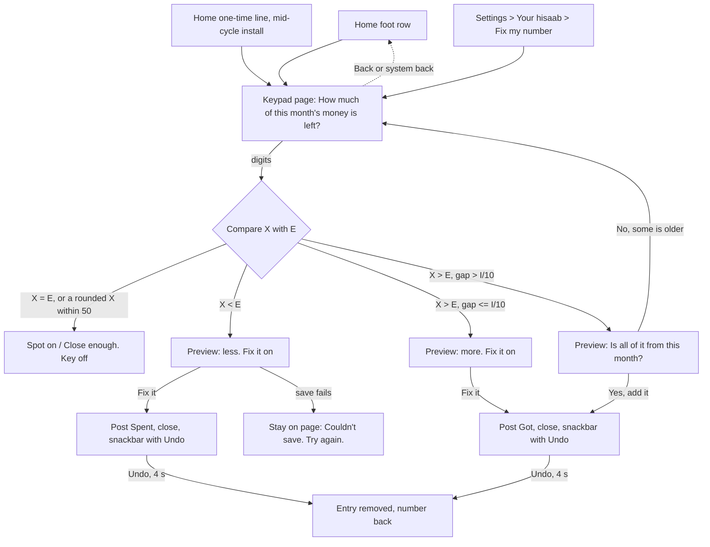

# Fix my number: the comparison rule, entry points and the keypad page

> **Status: proposed (2026-11-13).** Nothing here is in SPEC, PLAN, UI_DESIGN or DECISIONS, and no code exists. Source: case study 33 §4.1 (P1) and "Owner answers"; case study 34 (research, test plan unrun). Binding owner answers: Q6 stays closed (a one-time Home line, no onboarding question); a figure *higher* than hisaab's posts a *Got* "Not logged"; "Not logged" stays visible in Spends and in the Ask AI export; no limit on fixes per day. Copy is a placeholder for `design-content`, styling for `design-ui`, motion for `design-motion`. Accounting, edge cases, issues and spec edits are in `02-accounting-and-edge-cases.md`. Placement in section 3 is for `design-ia` to confirm.

## 1. The crux: what hisaab compares against, and what it asks

### 1.1 The problem
"How much money do you have right now?" asks for **all** the user's money. BR-3's pool counts only this cycle's *Got* entries. So the answer includes money hisaab never counted: a buffer, an emergency fund, last month's leftover, and (day 1 of a cycle) all of last cycle's leftover. The *higher* branch would post a *Got* for it and inflate the hero. Case study 34 §C also warned that `K` includes `Sv_before` (savings that may already have left the account), so subtracting `K` from the answer can double count.

### 1.2 The rule (chosen)
**Ask about this month's money only, compare it with what hisaab expects the user still holds of this cycle's money (`E`), and put a second question in front of any large *higher* figure.**

```
E = remaining + B + R
  = I − (S_prev + R_t + S_today)  −  (Sv_before + Sv_rule_today + Sv_extra_today)
```
`E` is this cycle's income less everything already spent and already saved out. It **keeps** the money earmarked for bills and savings still to come (`B`, `R`), because that money is still in the account. It **drops** `Sv_before` and today's saves, because a *Saved* entry says the money has left. So `E` is the figure a user can honestly read off their accounts for "this month's money", with no subtraction by them. The app then does the sums:

```
gap = E − X              X = the figure the user typed (whole rupees)
gap > 0  -> post Spent gap  (money is missing)      new remaining = X − B − R
gap < 0  -> post Got  −gap  (money is extra)        new remaining = X − B − R
```
After either, `E = X`, which is the proof that the comparison is apples to apples. The user is never asked to take out bills or savings; the app does it (Tesler).

**The second question (the guard).** When `gap < 0` and `−gap > I ÷ 10`, nothing is posted yet. The preview turns into: "That's ₹30,000 more than hisaab thought. Is all of it from this month?" with two keys, *Yes, add it* and *No, some is older*. *No* returns to the keypad with the line "Count only this month's money." and the typed digits kept. The threshold (10% of `I`) is a starting guess for the owner to confirm; it is the only number in the design that is not derived.

### 1.3 Options weighed

| Option | For | Against | Verdict |
|---|---|---|---|
| **A. Scope the question to this month's money** (+ guard on large *higher*) | No stored state; the common case is a one-line difference from V1; fits the mid-cycle installer ("how much of this month's pay is left?"); the guard catches the rest | The user must leave out older money, and a small buffer (under 10% of `I`) can still slip through | **Chosen** |
| B. Anchor on the first fix (record a starting buffer, then compare deltas) | Handles a buffer exactly | Stores a figure the pool is never computed from (D120: "computed, never stored"); it drifts as soon as the buffer is touched; day 1 of every cycle needs a new anchor; a hidden number the user cannot see or explain (principle 86) | Rejected |
| C. Ask only about spending money ("What can you still spend?") | Leaves out buffers by wording | Makes the user subtract bills and savings in their head, the sum the app exists to do (Tesler); unknown to most people | Rejected |
| D. Cap or guard the *higher* branch only | Cheap | Alone, it leaves the lower branch wrong for buffer users (they type a total and see "higher by ₹25,800" even though they forgot ₹4,200) | Folded into A as the guard |
| E. Skip the *higher* branch | Safest | Contradicts the owner's answer P1-2 | Not allowed |

Why the guard is only on *higher*: a *lower* gap makes the hero smaller and shows its cause; a wrong *higher* gap makes the hero **bigger than the money**, which is the harmful error. Both stay undoable.

### 1.4 Worked numbers
SPEC example: `I = 45,000`, cycle 4 Oct to 3 Nov, `t` = 26 Oct, `D = 9`, `B = 1,200`, `K = 0`, `S_prev = 27,150`, ₹420 spent today. `P = 16,650`, `A = 1,850`, hero ₹1,430, `remaining = 16,230`, so **`E = 16,230 + 1,200 = 17,430`** (check: `45,000 − 27,150 − 420`). Guard line: `I ÷ 10 = 4,500`.

| Case | User types `X` | `gap` | Posts | `P` | `A` | Hero | `remaining` |
|---|---|---|---|---|---|---|---|
| Before any fix | | | | 16,650 | 1,850 | 1,430 | 16,230 |
| **1. Forgot ₹4,200** (money really left: 13,230) | 13,230 | +4,200 | *Spent* ₹4,200 | 12,450 | `floor(12,450 / 9)` = 1,383 | 1,383 − 420 = **963** | 12,030 (= 13,230 − 1,200) |
| **2. hisaab under-counts ₹1,000** (a gift or refund never logged) | 18,430 | −1,000 | *Got* ₹1,000 | 17,650 | `floor(17,650 / 9)` = 1,961 | 1,961 − 420 = **1,541** | 17,230 (= 18,430 − 1,200) |
| **3. ₹30,000 buffer, types the total** | 47,430 | −30,000 > 4,500 | nothing yet: second question | | | | |
| 3 then *No*, retypes this month's | 17,430 | 0 | nothing | 16,650 | 1,850 | 1,430 | 16,230 |
| 3 then *Yes* (the owner's own buffer is "this month's") | 47,430 | −30,000 | *Got* ₹30,000 | 46,650 | 5,183 | 4,763 | 46,230 |
| 3b. Buffer and also forgot ₹4,200, types this month's only | 13,230 | +4,200 | as case 1 | | | | |
| 3c. Same user types the total (43,230) | 43,230 | −25,800 | second question, then *No*, retype 13,230 = case 1 | | | | |
| Mid-cycle install on 26 Oct, 36,000 already spent, ₹9,000 of the pay left (`S_prev = 0`, `A = 4,866`) | 9,000 | +36,000 | *Spent* ₹36,000 | 43,800 − 36,000 = 7,800 | 866 | 866 | 7,800 |

Previews: case 1 "Each day gets about ₹467 less" (1,850 − 1,383). Case 2 "about ₹111 more" (1,961 − 1,850). The wrong model in case 3 would have made every day ₹3,333 bigger for money the pay never funded; the guard prevents it. A buffer **under** ₹4,500 passes the guard and is posted; the preview still shows its effect, and Undo is the net (open question 1).

### 1.5 The question and the helper (working copy)
- Title: "How much of this month's money is left?" Helper: "Bank and cash together. Leave out older savings." The alternative "How much money do you have right now?" (study 34 V1/V2) is the control in the unrun test; add this title as a sixth variant (V6) in that script and fall back to V2 if V6 loses.
- The page **never** says "we'll take out your bills and savings" as a promise about the typed figure: the typed figure is compared with money that still contains the bills' money. After the fix the preview says what the hero becomes.
- The page shows hisaab's own figure only **after** a digit is typed ("hisaab thought ₹17,430"), so the user reads their bank first and is not anchored (principle 87).

## 2. Flow


Every state has an exit: Back, system back or the scrim closes with nothing saved and typing dropped.

### Task and tap counts
| Task | Before (today) | After | Note |
|---|---|---|---|
| Put right ₹4,200 of forgotten spends, number known (5 digits) | Find and add each item: 3 items × (Add, digits, Next, tile) = about 3 × 8 = 24 taps, and the items must be remembered | Home row 1, digits 5, *Fix it* 1 = **7 taps** | |
| Same from Settings | | Settings 1, row 2, digits 5, *Fix it* 1 = 9 | fallback only |
| Large *higher* figure | | 7 + *Yes, add it* 1 = 8; or *No*, retype, *Fix it* = 7 + 1 + n | |
| Equal | | 1 + digits, then Back | nothing saved |
| Add path | Add, digits, Next, tile | **unchanged** | no tap, field or order change |

## 3. Entry points (options for `design-ia`; not final)

| # | Entry | When | Priority and notes |
|---|---|---|---|
| 1 | **Home foot row** "Fix my number", quiet: sunk, 56dp, icon and text only, no marigold, below the Today list and *See all* | Always, except *No income* (BR-5 #1). Also in the over states (the over card keeps *See where it went* as its one next step; the foot row is not a second next step) | The permanent door. Thumb-zone friendly because it ends the scroll, but can be missed (issue I-1) |
| 2 | **Settings > Your hisaab** row "Fix my number" | Always | Fallback; also the door for anyone who does not scroll Home |
| 3 | **One-time line** in the nudge slot: "Already spent some this month? Fix my number" | Only when the install is mid-cycle (first Home visit's cycle started before the install day); shown once: written as *seen* when it is on screen with Home visible, as the missed-log line does (`docs/features/habits/08-missed-log-line.md` §1); never again after it was seen, tapped or not | **Slot order, to confirm:** waiting bill, due-soon bill, **install line**, missed-log line. Bill lines are the money guarantee. The install line precedes the missed-log line because it is rarer and has a short window (habits need 14 days, so the two almost never meet). If a bill line holds the slot on day 1 the install line waits for the next evaluation point; the foot row is always there |
| 4 | The over card | **No.** Not offered (not a second next step; shame-adjacent) | Rejected |

The one-time line is a pointer, not an onboarding question: onboarding still asks three (Q6 stays closed). It needs the install day; the build should reuse an existing stored date (the income rule's `created_at`) rather than a new column, and an *seen* flag in a preference. Both wiped with *Delete everything*.

## 4. The keypad page: states and wireframes
The page is a full page or sheet opened from any entry, **not** the Add tray. It copies the Add step 1 anatomy: amount at the top, one fixed-height **preview slot** (two lines, never resizes between states), the fixed keypad, and the action in the keypad's bottom-right key (where *Next* sits). The keypad order and keys are the app's, unchanged. Back is top-left. The slot is read by TalkBack as a polite live region after a 400ms pause.

**W1 Home foot row** (end of Home's scroll)
```
 Today                  See all
 Chai                      ₹40
 Lunch                    ₹380
 ------------------------------
 [ icon  Fix my number     >  ]      <- sunk row, 56dp, text + icon
 =========== dock ==============
  Home      [ Add ]      Spends
```

**W2 One-time line** (nudge slot, mid-cycle install, shown once)
```
 [ icon Already spent some this month?  > ]
   Fix my number
```

**W3 Empty** (opened; nothing typed; key off)
```
 <  How much of this month's money is left?
              ₹ 0
 Bank and cash together.
 Leave out older savings.                 <- helper, replaced by the preview once a digit is typed
 [1][2][3]
 [4][5][6]
 [7][8][9]
 [<][0][Fix it]  (off)
```

**W4 Lower** (typed 13,230)
```
 <  How much of this month's money is left?
          ₹ 13,230
 That's ₹4,200 less than hisaab thought.
 Each day gets about ₹467 less.
 [1][2][3] ... [<][0][Fix it]  (on)
```

**W5 Higher, small** (typed 18,430)
```
          ₹ 18,430
 That's ₹1,000 more than hisaab thought.
 Each day gets about ₹111 more.             [Fix it]
```

**W6 Higher, large: the second question** (typed 47,430; keypad stays, the action key becomes the two answers)
```
          ₹ 47,430
 That's ₹30,000 more than hisaab thought.
 Is all of it from this month?
 [  Yes, add it  ]   [ No, some is older ]   <- two equal 56dp keys, neither marigold-bare
 (No -> same page, digits kept: "Count only this month's money.")
```

**W7 Equal / close** (typed 17,430, or 17,400 which is within 50 of a rounded answer)
```
 Spot on. Nothing to fix.     |   Close enough. Nothing to fix.
 [Fix it]  (off)
```

**W8 Done** (page closes to where it opened; Home reflows with the usual motion; success haptic; snackbar 4 s, or until dismissed with TalkBack, D105)
```
 Safe to spend today          ₹963
 ...
 ---- snackbar ---------------------
 Fixed. Today you can spend ₹963.   [Undo]
```
Undo removes the entry and the number goes back (peak-end: the moment is the hero correcting itself, calm, no praise).

**W9 Failure** (the save did not go through; typing kept)
```
 Couldn't save. Try again.                [Fix it]
```
**W10 Spends / Every entry row** (hidden category, visible, swipe deletes with Undo)
```
 Not logged · Spent               ₹4,200
 Added to match your money
```

## 5. Copy and states (working draft; `design-content` owns the words)
| State | Line |
|---|---|
| Lower | "That's ₹{gap} less than hisaab thought. Each day gets about ₹{n} less." |
| Higher | "That's ₹{gap} more than hisaab thought. Each day gets about ₹{n} more." |
| Lower, over for the cycle | "That's ₹{gap} less than hisaab thought, and ₹{m} short of the bills still to come." (the over card then reads as FR-HO-5) |
| Equal | "Spot on. Nothing to fix." |
| Close (rounded answer, within 50) | "Close enough. Nothing to fix." |
| "about" | Prefix when `X` is a multiple of 100 and the gap is over 50 ("about ₹4,200 less"): people answer roughly (study 34) |
| Last day (`D = 1`) | "Today gets ₹{gap} less." (the day takes it all) |
| Saved | "Fixed. Today you can spend ₹{hero}." |
Banned and avoided: transaction, debit, credit, budget period, Oops, balance, reconcile, true-up. No red, no green; direction is carried by words ("less", "more"), not colour.
