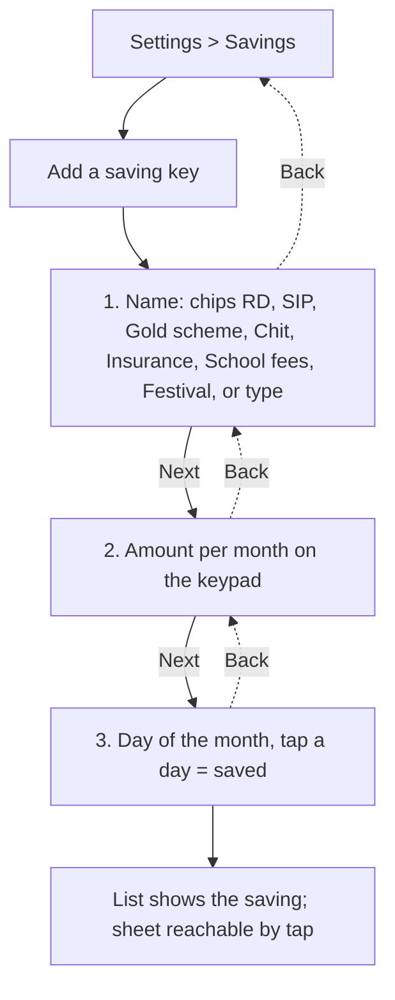
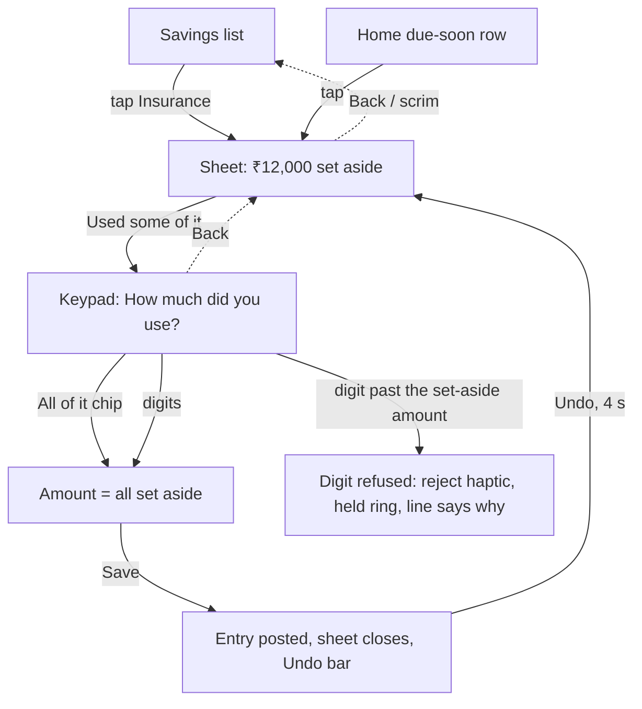

# Yearly costs: UX flow (setup and "used")

> **Built 2026-11-13 (plan `docs/superpowers/plans/2026-11-13-yearly-costs-and-used.md`; SPEC BR-19, FR-SE-1 AC-Y1 to AC-Y11, schema v5). The departures from this flow are listed at the end, under *As built*.**
>
> **Status: signed off 2026-11-13 (`docs/features/fix-my-number/08-design-qa-and-signoff.md` §8; X1, X5, X14, X19, X26, X27, X32, X37, X38, X42 and O5 to O8 applied below).** Nothing here is in SPEC, PLAN, UI_DESIGN or DECISIONS yet, and no code exists; SPEC wins once written. Wireframes now use the SPEC worked example's ₹12,000 (X42). Source: case study 33 §4.2 (P2′) and its "Owner answers" (2026-11-13: there **must be a "used" action**; no reminder on a yearly saving; no new setting). Copy is a placeholder for `design-content`; styling is for `design-ui`; motion for `design-motion`. This file is longer than the usual ~150 lines because the owner asked for the whole flow in one place; split it into `02-` and `03-` when approved.

## 1. What this is

A yearly or term cost (insurance, school fees, Diwali) is set up as a **monthly saving** (D120), so the hero never takes the whole hit in one cycle. D35 is untouched: the bill sheet stays monthly. Two things are new:

1. **Setup:** three new name chips and one caption on the existing *Add a saving* flow. No new question, field or setting.
2. **Used:** a way to say "I paid the cost from what I set aside", so "still set aside" doesn't stay falsely high.

## 2. Journey (stages, with the feeling to protect)

| Stage | Action | Thought | Feeling to protect | Touchpoint |
|---|---|---|---|---|
| Set up (any month) | Settings > Savings > *Add a saving* > chip *Insurance*, ₹1,000, day 5 | "A twelfth of it a month. Fine." | Relief, in control | Add a saving |
| Each month | Engine posts "Insurance ₹1,000 · saved" on day 5 | (none; Home's Today row says it) | Calm: hero doesn't move on the day (BR-3) | Home Today list |
| A skipped week or month | Nothing happens. Delete the month's row to skip it (BR-10) | "Skipped this month" | No blame, no count | Every entry |
| Payday | Nothing special. `K` is part of `P` already | | | Home |
| The cost falls due | User pays the insurer from the bank | "Now tell hisaab it came from there" | Not confused: *which* button? | Settings > Savings > Insurance |
| Marking it used | *Used some of it* > amount > *Save* | "My daily number didn't change. Good." | Satisfaction, then calm | Saving sheet, snackbar |
| Overspend | Pays more than was set aside; adds the rest as a normal spend | "OK, the rest hits my day" | Honest, not shamed (inform, never shame) | Add, Home over-today state |
| Backup and restore | Used entries travel with the backup (BR-16) | | Nothing lost | Backup file |

## 3. Setup

### 3.1 Flow (existing three questions; nothing added)



Every question has Back, and Back from question 1 returns to the list with nothing saved. Taps from Home: Settings 1, Savings 2, *Add a saving* 3, chip 4, Next 5, digits *n*, Next, day = **7 + n**, the same as a monthly bill (no extra tap).

### 3.2 What changes in the flow

| Where | Change | Why |
|---|---|---|
| Name chips | After the existing four (RD, SIP, Gold scheme, Chit, never reordered) add *Insurance*, *School fees*, *Festival*. Seven chips, one wrapping row set | Hick: seven short chips is fine; a chip is faster than typing |
| Amount question | For the three new chips only, a caption under the amount (X26, copy deck R11): "Paid once a year? Each month, put in the cost divided by 12." then "When you pay it, tap Used some of it." (the second sentence is free and is the first discovery cue, X38). The body scrolls above the pinned keypad if it does not fit | Tesler: the app helps with the maths without a field |
| "Premium ÷ 12" | **Cannot be computed** without asking for the yearly cost, which is a fourth question. So the caption states the rule and the user divides. Rejected: a "yearly amount" toggle (4th question), a ÷12 key (the keypad is fixed), a calculator row | Three-question pattern and fixed keypad |
| Day question | Unchanged. No "due month" question | No reminder wanted (owner, P2′-2), no setting |
| Category and icon | Same as any saving: hidden `savings` category, piggy-bank glyph, no Icon row | D120 |

### 3.3 Wireframes (thumb zone at the bottom; `[ ]` is a key)

**S1 Name**
```
 <  Add a saving
 What is it for?
 [RD] [SIP] [Gold scheme] [Chit]
 [Insurance] [School fees] [Festival]
 ____________________ (or type a name)

 ------------- thumb zone -------------
 [            Next            ]
```

**S2 Amount (chip = Insurance)**
```
 <  How much do you put in
    Insurance each month?
          ₹ 1,000
 Paid once a year? Each month, put
 in the cost divided by 12.
 When you pay it, tap Used some of it.
 [1][2][3]
 [4][5][6]
 [7][8][9]
 [<][0][Next]
```

**S3 Day:** the existing 1-31 grid; tapping a day saves.

**S4 The saving sheet, before anything is used** (the existing paper slip)
```
 SAVING · Insurance          (piggy-bank glyph)
 ₹1,000   Put in every month on day 5
 [stamp: Put in 5 Oct]
 ------------------------------
 ₹12,000 set aside
 Paid the cost from this? Tap
 Used some of it.               <- hint on the three yearly chips only (O6), until test T7 shows the key alone is understood
 [  Used some of it  ]          <- outlined key, mid-sheet
 Amount   ₹1,000   >
 Day      5th      >
 Name     Insurance>
 Next put-in on 5 Nov
 ------------- thumb zone -------------
 [ Delete saving ]              <- sunk, at the foot, far from Used
```
The balance line and the *Used some of it* key show only when the saving has something set aside (above ₹0), on **every** saving (RD too, O6). The hint ("Paid the cost from this? Tap Used some of it.") shows **only on the three yearly chips** (it says "the cost", which reads oddly on an RD) and stays until hallway test T7 shows the key alone is understood (4 of 5), then it is dropped (X38). Before the first put-in the slip is exactly today's.

## 4. The "used" action

### 4.1 Where it lives

**In the saving's own sheet**, under its balance line. Why not Home's due-soon line: that line is the *monthly put-in* ("Insurance, ₹1,000, due on Thu"), not the cost's date. The cost's date is not stored (no reminder, no field), so Home has no right moment to ask. The due-soon row does open the same sheet (FR-HO-3), so the key is also one tap from Home in the five days before a put-in. The key is deliberately not beside *Delete saving* (Fitts and error prevention: two very different actions must not sit under one thumb).

Discovery is the weak point (see issue I-1): the setup caption's second sentence, the sheet's hint (yearly chips only) and the list's third line "₹12,000 set aside" are the only cues. No push, no Home banner (principle 48). Rung 2 (a tappable *Saved* row) is **not pre-approved**: decide only if the hallway test T7 fails (O21).

### 4.2 Task flow



Taps from Home: Settings 1, Savings 2, the saving 3, *Used some of it* 4, **All of it** 5, *Save* 6 = **6 taps** when the whole pot is used (the common case). Typing an amount: 5 + digits. Every state has an exit: Back or the scrim closes with nothing saved; unsaved typing is dropped.

### 4.3 The keypad page

> Interaction detail (states, the *All of it* chip, refusal, focus, TalkBack) is in `docs/features/fix-my-number/04-interaction.md` §9, kept consistent with the Fix my number keypad.

**S5 Used keypad** (the shared `Keypad`, **pinned** with the typed amount; title and slot scroll; keys 56dp, 48 when short; a **full-width *Save*** under it, X1, X5)
```
 <  How much did you use
    from Insurance?
          ₹ 12,000               [All of it]
 ₹12,000 is set aside.
 Nothing will be set aside.        <- "₹{left} will still be set aside." while typing
 Your daily number doesn't change.
 [1][2][3]
 [4][5][6]
 [7][8][9]
 [00][0][<]
 [         Save          ]  (marigold, full width)
```
- The amount starts empty; *All of it* fills the whole set-aside amount (one tap, a prefill, not a field). The first key after it replaces it (FR-AD-8). **Tapping *All of it* again clears the amount** (X19: a filter chip toggles, and every `onTap` must do something).
- Live line (deck strings, X26): "{amount} will still be set aside." (zero form "Nothing will be set aside."). Static reassurance: "Your daily number doesn't change." It answers the user's first worry before they tap. "So far" is dropped (it implies a total still growing).
- **S5b at the cap:** a digit past the set-aside amount is refused (the Put in extra pattern, FR-SE-1 AC-3): reject haptic, the amount shakes, **a 2dp ring is held until the next valid key** (X14; `Shake` is skipped under reduced motion), and the line "That's all you have set aside. Add the rest as a spend." (O7: refuse; the rest is a normal spend). No red.
- **S5c nothing set aside** (reached only if the balance fell to ₹0 behind the sheet, e.g. a put-in was deleted): the line reads "Nothing is set aside to use." and *Save* is off. ₹0 is refused.
- Save: `success` haptic (`Haptics`), the sheet closes, the list is back under it.

**S6 After saving (list + Undo bar, the peak-end moment)**
```
 Savings
 Insurance          ₹1,000 · day 5
                    Every month on the 5th
                                           <- third line "₹X set aside" only above ₹0 (X37); gone here
 RD                 ₹5,000 · day 10
                    Every month on the 10th
                    ₹5,000 set aside       <- third line, above ₹0
 ...
 ₹17,000 put in since Nov
 ₹5,000 still set aside
 [ Add a saving ]
 [ Put in extra ]
 ---- snackbar ----------------
 Insurance: ₹12,000 used         [Undo]
```
The snackbar holds 4 s (until dismissed with TalkBack, D105; O10). It states what happened (name first, D132) and that nothing else moved. Undo deletes the entry, and the sheet need not reopen. The Savings-list row's **third** line "{amount} set aside" is below the schedule line, which stays; the row grows from 64 to about 84dp (X37).

### 4.4 Accounting rule (the proposal)

**A *Used* entry is a fourth kind of entry. It is in no BR-3 symbol.** The money was set aside in `K`, and `K` already took it out of `P` in the cycles it was put in. Past cycles' puts are not in this cycle's `I` or `K` at all, so a payment from the pot does not touch this cycle. The bank balance falls, the hero is unaffected.

| Entry | `I` | `K` | `B` | `S_prev` | `S_today` | `R_t` | `remaining` | Saved total | Used total |
|---|---|---|---|---|---|---|---|---|---|
| Spent | | | | in | in | | in | | |
| Saved (rule) | | in | | | | | | + | |
| Saved (extra) | | in | | | | | in (today) | + | |
| **Used** | no | **no** | no | **no** | **no** | no | **no** | no | + |

- It never reaches BR-4, BR-5, BR-6 (bar, bites, rail), BR-6a, BR-7 (pace counts *Spent* only), BR-8 (the morning note), BR-13/14 (insights, *Where it went*) or BR-17 (habits learn only *Spent*). It is dated today and has no date picker.
- **Balance of a saving** = Σ *Saved* entries posted by that saving − Σ *Used* entries linked to it, floored at ₹0. Computed, never stored (D120). Linked by the saving's rule id in its own column, **not** by `recurring_id`, because `(recurring_id, date)` is unique and a use on a put-in's date would be refused.
- **Why not a negative *Saved*:** it would drop `K`, raise `P` and make the hero jump, as the worked example shows (§4.5).
- **Why not *Spent*:** it would land in `S_today`, show "over today", and put saving into *Where it went* (the pitfall in case study 17).

**Amount limits:** 1 to the saving's balance. More than the balance cannot be recorded as *Used*: see §4.6.

### 4.5 Worked example (SPEC style)

Inputs: `I = 45,000`, `B = 1,200`, `S_prev = 27,150`, cycle 4 Oct to 3 Nov, `t` = 26 Oct, `D = 9`. An *Insurance* saving of ₹1,000 on the 5th, started 5 Nov 2025: it has put in 12 times (₹12,000). This cycle's put-in was on 5 Oct, so `Sv_before = 1,000`, `R = 0`, `K = 1,000`. Today ₹420 is spent.

| Step | `K` | `P` | `A` | Hero | `remaining` | `tomorrow` |
|---|---|---|---|---|---|---|
| Before | 1,000 | 45,000 − 1,000 − 1,200 − 27,150 = 15,650 | floor(15,650 / 9) = 1,738 | 1,738 − 420 = **1,318** | 15,650 − 420 = 15,230 | floor(15,230 / 8) = 1,903 |
| Used ₹12,000 | 1,000 | 15,650 | 1,738 | **1,318** | 15,230 | 1,903 |

Nothing moved. Footer: "₹12,000 put in since Nov" and "Nothing is set aside now." Spends, cycle 4 Oct to 3 Nov: "Spent ₹27,570 · Saved ₹1,000" (the *Used* amount is **not** on this line, O5, X32; it shows in Every entry and on the Savings list).

What the wrong models would do: as *Spent*, `S_today = 12,420`, so the hero is ₹0 and "₹10,682 over today", and `remaining = 3,230`. As a negative *Saved*, `K = −11,000`, `P = 27,650`, `A = 3,072` and the hero rises to ₹2,652 for money that is gone.

**More than was set aside** (premium ₹15,000, set aside ₹12,000): *Used* ₹12,000 changes nothing. The user adds the other ₹3,000 in Add, *Bills*: `S_today = 3,420`, `A = 1,738`, so "₹0 · ₹1,682 over today", `remaining = 15,650 − 3,420 = 12,230` and `tomorrow = floor(12,230 / 8) = 1,528`. The existing calm over-today state (FR-HO-5) says it; the days after share the cost.

### 4.6 Edge cases

| # | Case | Rule |
|---|---|---|
| U1 | Used more than was set aside | Refused on the keypad (S5b). The rest is real spending, added in Add like any bill (O7, accepted). The excess-as-*Spent* alternative is rejected: it needs a rule so the excess does not read "over today" |
| U2 | Used before the first year is complete | Same as U1: the balance is only what was put in so far, so most of the cost is spending. This is honest: a saving started in November can't cover a March premium in full. The caption in 3.2 does not promise otherwise |
| U3 | Used twice (second part of one cost, or a double tap) | Allowed up to the remaining balance. The balance line on S4 and S5 already shows the drop, so the second use is a visible choice. Double taps are dropped (`droppable()`) |
| U4 | Wrong amount | Undo within 4 s. Later: swipe the *Used* row in *Every entry* (deletes with Undo, BR-10), then use again. A *Used* entry is never edited in the tray, like a *Saved* one (D120) |
| U5 | The saving is deleted afterwards | The rule stops and past entries stay (BR-9). The deleted saving's balance leaves "still set aside" (the line counts active savings only) and stays in "put in since" (history). The Undo bar says "Insurance deleted. What you put in stays in your history." *Used* is then not reachable; use it **before** deleting, or Undo the delete first. No extra *Used* step on delete (O8) |
| U6 | A put-in is deleted (skip) after a use | The balance floors at ₹0, never negative. The *Used* entry is not blocked or edited (reversibility over a dialog) |
| U7 | The saving keeps running after a use | Yes. It keeps posting each month for next year, so the user does nothing |
| U8 | Skipped months | Unchanged: delete the row ("Insurance skipped this month"). The balance is lower, so the keypad cap is lower |
| U9 | *Put in extra* | Has no saving to belong to, so it adds to "put in since" and never to a balance. Out of scope: a named extra |
| U10 | Restore or backup | `kind = used` is backed up and restored with its link. An older backup without it restores as before |
| U11 | Cycle boundary | A *Used* entry dated today belongs to today's cycle for display only (Spends); it moves no number in either cycle |
| U12 | Paid it as *Spent* by habit | The hero takes the hit **and** the pot stays high. Real risk (I-3). Fix is to delete the *Spent* entry and mark *Used* |

### 4.7 Where else it shows

| Place | What it shows |
|---|---|
| Savings list, each row | A **third** line "{amount} set aside" when above ₹0 (cue for the Used key); the schedule line "Every month on the 5th" stays as the second (X37). Every saving gets it (O6) |
| Savings list footer | Line 1 unchanged: "₹X put in since {Mon}" (gross, never "worth" or "balance"). Line 2 only when any saving has something set aside or a use exists: "₹Y still set aside" (zero form "Nothing is set aside now.") |
| Home, Today list | **Two lines (X27):** line 1 the saving's name "Insurance", line 2 the kind word "Used from savings", the amount at the end, with the piggy-bank glyph; no colour, no bite, no tap; swipe deletes with Undo (like FR-HO-4's saving row). Spoken: "Insurance. Used from savings 12,000 rupees." The kind word and the saving name are separate placeholders |
| Spends, FR-SP-4a | **Not shown.** The line is "Spent ₹27,570 · Saved ₹1,000" (plus *Not logged* when present): three parts at most (O5, X32), because *Used* is not spending. *Used* shows in Every entry and on the Savings list. Never in bars, percentages, week bars, pace or insights |
| Every entry | The same two-line row, plus the extra line "Paid from what you set aside." Swipe to delete with Undo |
| Ask AI / CSV | `kind` gains `used`, category `savings`, note the saving's name. The facts clause says it is paid from savings, so the AI doesn't read it as spending (BR-15) |

## 5. Error prevention and recovery

| Risk | Prevention or recovery |
|---|---|
| Using more than exists | Digits past the balance are refused with a plain reason (constraint, not an error dialog) |
| Marking used by mistake | Undo bar, then swipe-delete in *Every entry*. No "Are you sure?" |
| Used and Delete confused | Different places in the sheet; Delete is `sunk`, last, and has Undo (D35) |
| Hero scare | "Your daily number doesn't change." sits on the keypad before the user commits |
| A 5-year-old's wording | "Used some of it", "set aside", "put in". No "withdraw", "balance", "worth", "transaction", "budget period", "Oops". No red, no green; state is words and fill |
| A failed save | Keeps the keypad open: "Couldn't save. Try again." |
| No new setting | None. Chips, one caption, one key |
| Fixed Add path | Untouched. Used lives in Settings, off the path, and moves nothing in the Add tray, keypad or dock |

## 6. Cognitive walkthrough (first-time user, the "used" task)

| Step | Will they know what to do? | Sees the control? | Links it to the goal? | Sees progress? |
|---|---|---|---|---|
| Open the saving | **Weak:** nothing on Home says "tell me when you pay" | The list row's third line "₹12,000 set aside" helps | Partly | n/a |
| Find *Used some of it* | Yes, with the hint line | Yes, mid-sheet | Yes | Balance shown |
| Type or tap *All of it* | Yes | Yes | Yes | The "will be left" line |
| Save | Yes | Yes, bottom right | Yes | Snackbar and list update |

## 7. Issues (severity 0 to 4)

| # | Step | Problem | Heuristic | Sev | Fix |
|---|---|---|---|---|---|
| I-1 | Finding Used | Only reachable in Settings; there is no cost date, so no trigger | Recognition over recall (#6) | 3 | Setup caption's second sentence, the hint on the sheet (yearly chips) and "set aside" on the list row (third line). A due date or reminder would fix it but was declined (P2′-2); rung 2 only if T7 fails (O21) |
| I-2 | Used keypad | "Used" is a new word beside "saved" (BR-8 note wording, D121) | Match the real world (#2) | 2 | `design-content` blind read; keep "used some of it" in the key and "Used" on rows |
| I-3 | Paying in Add by habit | Double count: the hero hit and the pot stays high | Error prevention (#5) | 3 | Hint on the sheet; Every entry delete. No clever matching on notes (rejected: guesswork, a new field) |
| I-4 | Over the balance | The user must add the rest as a normal spend (two tasks) | Flexibility (#7) | 2 | Say so on the keypad. Alternative B in U1 if tests show confusion |
| I-5 | Deleted saving with a balance | *Used* is no longer reachable | User control (#3) | 2 | Delete's Undo bar says what stays; use first |
| I-6 | Spends line grows | Noise on a calm screen | Aesthetic and minimalist (#8) | 1 | Resolved (O5): *Used* is kept off the line |
| I-7 | Caption "divided by 12" | A first-year shortfall is not explained | Help (#10) | 1 | Accepted; U2 describes it |

## 8. Spec edits needed (listed, not written)

| Doc | Change |
|---|---|
| SPEC BR-3 | A *Used* entry is in no symbol; add `Used` to the table with "in no symbol" and the §4.5 example |
| SPEC BR-4, BR-7, BR-8 | One-line note: *Used* is outside `S_today`, `remaining`, `V_prev` and yesterday's rebuild |
| SPEC BR-9 | *Saved* rule kinds unchanged; a *Used* entry links to its saving by a separate column; delete keeps it |
| SPEC BR-10 | Fourth entry kind *Used*: amount 1 to the saving's balance; today only; delete with Undo; never edited in the tray |
| SPEC FR-SE-1 Savings | Chips *Insurance*, *School fees*, *Festival*; the amount caption; the balance line and *Used some of it* key on the sheet (every saving; hint on yearly chips only); the pinned keypad page with `00` and a full-width *Save*, and its ACs; list row's third line; footer line 2; delete's Undo wording |
| SPEC FR-HO-4 (Today list) | The two-line *Used* row. **FR-SP-4a gets no *Used* part** (O5): three parts at most |
| SPEC BR-15 / BR-16 | CSV `kind` gains `used`; prompt facts clause; backup includes it |
| SPEC §5 | New E-rows for U1 to U6; Glossary: "Used" and "set aside" |
| UI_DESIGN | The saving sheet with balance and key; the Used keypad page; the list footer; the Today row; a mockup `42-yearly-costs` |
| PLAN §2 | Savings row mentions yearly-cost chips and *Used* |
| DECISIONS (next free IDs) | (a) Yearly costs are a monthly saving, not a bill; D35 stays. (b) *Used* is a fourth entry kind that touches no BR-3 symbol. (c) Over the balance, the rest is a normal spend. (d) No due date or reminder on a yearly saving. (e) "Used" and "set aside" are the words |
| Schema | A new `kind` value and a link column; no new table. A migration; the backup version bumps |

## 9. Open questions for the owner (answered by 08 §8 unless marked)

1. **Over the balance (U1):** refuse and add the rest as a spend (O7).
2. **A saving deleted with a balance (U5):** no extra step; the delete's Undo says what stays (O8).
3. **Spends line:** *Used* is **not** on the line; it shows in Every entry and the Savings list (O5, X32).
4. **Footer second line:** still open as drafted (gross "put in since" plus the new line); not covered by 08.
5. **Used on every saving** (RD too): yes, only when something is set aside; the hint on the three yearly chips only (O6).
6. **Discovery (I-1):** Settings-only, with the cues above; rung 2 is not pre-approved (O21).
7. **A named *Put in extra*** into a saving (U9): later, if asked.

## Source scope
`docs/design-research/case-studies/33-product-gap-analysis.md` (§4.2, Owner answers), `docs/design-research/case-studies/17-savings-and-rd.md`, SPEC BR-3, BR-4, BR-9, BR-10, FR-HO-3, FR-SP-4a, FR-SE-1 (Savings), PLAN §2, DECISIONS D35, D118, D120, D123. No code was read.

Information architecture across all three features (nudge-slot order, *Used* discovery, labels, the Spends line): `docs/features/fix-my-number/03-information-architecture.md` (signed off 2026-11-13).

Motion for the *Used* flow (what moves instead of the hero, the keypad swap, Undo): `docs/features/fix-my-number/05-motion.md` (signed off 2026-11-13).

## As built

What the code does where this flow was open, or where the build chose:

| Point | As built |
|---|---|
| Schema | One migration, `005`, carries all of schema v5 (D191): the two hidden *Not logged* rows, `used` with `transactions.saving_id` (`REFERENCES recurring(id) ON DELETE SET NULL`, indexed) and `suggestion_state.asked_on`. A backup older than v5 gains them on its in-memory migration. |
| Set aside | Computed, never stored: `SetAside` (`lib/ledger/domain/set_aside.dart`) is put-ins posted by the saving's rule minus uses linked by `saving_id`, floored at ₹0. *Put in extra* is in no saving. |
| Caption (AC-Y2) | Keyed to the **picked pill**, held as `BillEditorInProgress.yearlyPill`; typing a name by hand, even "Insurance", never shows it (D191). |
| Cap | The *Used* keypad refuses a digit past the whole rupees set aside (reject, shake, held ring, the cap line) and `UseFromSavings` re-reads the set-aside in the write, so a put-in deleted behind the sheet refuses the save and refreshes the figure (E99). |
| Success haptic | Fires when the write finishes (`UsedDone`), not on a rolling figure: the Savings list's figures do not roll today. |
| Undo | Undo deletes the entry and does not reopen the sheet; the Settings door and the Home door each own their snackbar (`BillsBloc`, `HomeBloc`). Undo while Home is loading waits for the next good load. |
| Deleting a saving | "{saving} deleted. What you put in stays in your history." when the saving has had a put-in; read before the delete, since the reload no longer lists the rule (AC-Y10). |
| Hint on the sheet | "Paid the cost from this?" shows when the saving's name is Insurance, School fees or Festival (any case), since a saved rule has no other mark of the pill it came from. |
| Large text | At 2.0× text on a 320×568 window the amount, *All of it* and the keys do not all fit pinned; the keypad body hands over to its all-scrolling layout (every key reachable), instead of the pinned layout. |
