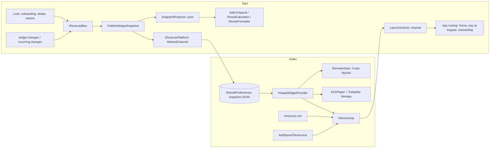

# Widget, Quick Settings tile and app shortcut: design

**Status:** design approved in chat on 2026-11-12 (D147). The owner kept the amount shown and took the research's recommendations for the rest. Waiting: review of this written spec, then the open choices in §15.
**Research:** [case study 31](../../design-research/case-studies/31-play-store-competitive-landscape.md), items 1 and 2.
**Mockup:** [38-widget-and-tile.html](../../design/mockups/38-widget-and-tile.html).
**Product docs already updated:** SPEC FR-WG-1 to FR-WG-8, FR-SE-6, E51–E57 and NFR-10; UI_DESIGN §10; PLAN M7.
**Next decision number:** D148.

## 1. Problem
hisaab's answer, *how much can I safely spend today?*, is the most glanceable number in any expense tracker. Today you have to find and open the app to see it. Logging a spend also starts with opening the app. Rivals (Money Manager, Monefy, Cashew) all have quick-add widgets.

**Success:**
- Today's safe-to-spend is readable from the home screen with no tap, and it is right after midnight, a bill day and payday, even if the app hasn't been opened.
- From the home screen, the pull-down or the launcher icon, a spend is logged with the same taps as in the app: Add → digits → Next → tile.
- Nothing about money is on the lock screen.
- No money maths, formatting or copy is duplicated outside Dart. Native code only picks and draws.
- No network, no new permission beyond what Android grants to every widget and tile.

## 2. What ships
| Surface | Does | Shows money |
|---|---|---|
| **Widget** *hisaab* (2×1, 2×2, 4×1, 4×2; placed at 4×2) | The hero in miniature on the hero's paper. Add key → keypad; elsewhere → Home | Yes (D147) |
| **Quick Settings tile** "Add a spend · hisaab" | Tap → (unlock) → keypad; long-press → Home | Never |
| **App shortcut** "Add a spend" | Long-press the launcher icon → keypad | No |
| **Settings › Shortcuts** | *Add a widget*, *Add to quick settings*, each opening Android's own dialog | No |

Look and copy: UI_DESIGN §10 and mockup 38. Behaviour: SPEC FR-WG and FR-SE-6. This spec covers **how** to build it.

## 3. Architecture


### New feature folder: `lib/shortcuts/`
| Path | Layer | Responsibility |
|---|---|---|
| `domain/entities/widget_snapshot.dart` | domain | `WidgetSnapshot` (version, written-at, look, strings, rows) and `WidgetDay` (one row) |
| `domain/snapshot_projector.dart` | domain, pure | Builds the rows from today's ledger state, day by day (§5) |
| `domain/usecase/publish_widget_snapshot.dart` | domain | Reads the ledger, runs the projector, hands the result to the platform |
| `domain/entities/launch_action.dart` | domain | `add`, `home`, `setUp`, parsed from a launch URI |
| `domain/repository/shortcuts_platform.dart` | domain | The port: publish, pin widget, add tile, can-pin, can-add, launch actions |
| `data/platform/android_shortcuts_platform.dart` | data | The `MethodChannel('hisaab/shortcuts')` adapter |
| `di/shortcuts_module.dart` | di | Registration |
| `shortcuts.dart` | barrel | Public surface |
| `lib/app/bloc/shortcuts_bloc.dart` | app | Like `RemindersBloc`: listens to the change streams, publishes, routes launch actions |
| `lib/settings/presentation/…` | presentation | The *Shortcuts* group (FR-SE-6) |

### Kotlin (`android/app/src/main/kotlin/com/widgetsandco/hisaab/`)
| File | Responsibility |
|---|---|
| `MainActivity.kt` | Adds the `hisaab/shortcuts` channel, delivers the launch URI from `onCreate` / `onNewIntent` (the activity is already `singleTop`) |
| `widget/HisaabWidgetProvider.kt` | `AppWidgetProvider`: picks today's row, chooses the size layout, sets click intents, schedules the next midnight |
| `widget/SnapshotReader.kt` | Pure Kotlin: parse JSON, `rowFor(LocalDate)`, the fallback when no row matches |
| `widget/EtchPaper.kt` | Draws the hero's paper into a `Bitmap` at the widget's size (a port of `DisplayEtchPainter`) |
| `widget/TodayBar.kt` | Draws today's bar into a `Bitmap` from the row's bar spec |
| `tile/AddSpendTileService.kt` | The tile |
| `res/layout/widget_{2x1,2x2,4x1,4x2}.xml`, `res/xml/hisaab_widget_info.xml`, `res/xml/shortcuts.xml` | Layouts, provider info (target 4×2, resizable), static shortcut |

### Why a MethodChannel and not `home_widget` (open choice, §15 #1)
We need Kotlin anyway: the tile, the pin requests, launch routing and the paper. The channel is about 5 methods. With our own channel the Flutter engine never starts in the background and there's no package to track. `home_widget` would save roughly 40 lines but adds a dependency for little. **Recommended: own channel.** PLAN §11 then drops `home_widget`.

## 4. The snapshot (the contract between Dart and Kotlin)
Written by Dart as one JSON string under one SharedPreferences key (`hisaab.widget.snapshot`). Kotlin never formats money or chooses words: every visible string arrives ready-made from ARB and `MoneyFormatter`.

```json
{
  "v": 1,
  "writtenAt": "2026-10-26T21:14:05",
  "look": "system",
  "strings": {
    "title": "Safe to spend today", "leftToday": "left today", "add": "Add",
    "addA11y": "Add a spend", "setUp": "Set up", "setUpBody": "Set up hisaab to see what's safe to spend today.",
    "stale": "Open hisaab to update"
  },
  "setUp": false,
  "rows": [
    {
      "date": "2026-10-26",
      "state": "onTrack",
      "hero": "₹1,430", "heroMuted": false, "over": null,
      "range": "Lasts till payday · about ₹9,300 spare",
      "days": "9 days", "daysLeft": "9 days left", "flag": "4 Nov",
      "bar": { "yellow": 0.773, "outline": false, "bites": [0.205, 0.022], "tick": null, "hatchFrom": null },
      "dots": { "count": 9, "today": "solid", "othersOutlined": false },
      "a11y": "Safe to spend today, 1,430 rupees. 420 rupees spent of 1,850. 9 days to payday, on 4 November. Lasts till payday, about 9,300 rupees spare."
    }
  ]
}
```
- `look` is the app's *Look* (`system`, `light`, `dark`); for `system` Kotlin reads the phone's night mode.
- `bar` holds fractions of the span, in drawing order from the start edge (BR-6). Only today's row has bites; future rows have none, by construction (§5).
- `state` is one of `onTrack`, `slowDown`, `overToday`, `overCycle`, with drawing rules from BR-5 and BR-6.
- `setUp: true` (no income, BR-5 #1) means `rows` is empty and the widget draws the *Set up* state.
- **Versioning:** Kotlin ignores a snapshot whose `v` it doesn't know and shows the stale state; Dart always writes the current `v`.
- **Size:** at most about 62 rows × about 600 bytes ≈ 40 KB. Fine for SharedPreferences.

## 5. Projection: every day until a cycle past payday
**Claim:** with no new typed entries, every future day's hero is already known, because the ledger only changes while the app is open (or when Android's restore or the user's file restore runs, both of which go through the app).

`SnapshotProjector.project(state, from: today, through: endOfNextCycle)` returns one `WidgetDay` per date. For each date `d`:
1. **Pretend the engine ran.** Rule occurrences (bills, savings, income) due in `(today, d]` that the engine would post on its next run count as posted on their day. Fixed bills post at their amount; changing bills keep waiting at their estimate (D123); card bills are never counted; income posts on payday and opens the next cycle (BR-1, BR-1a with any pay switch, D137's next-payday amount).
2. **Typed spending stays where it is.** Today's typed entries become `S_prev` for every `d > today`. No new typed entries are invented.
3. Build `CycleInputs` for `d` exactly as `GetCycleSummary` does, then call `SafeToSpend.compute`. The range line (BR-7) comes out of the same call: the pace is unchanged, so `E` grows and the spare moves.
4. Format with `MoneyFormatter` and ARB into the row.

**The trap:** `B` counts bills due in `(d, end]`. A bill due in `(today, d]` that the engine hasn't posted is in neither `B` nor `R_t`. If step 1 is skipped, `A` comes out too high on every bill day.

**Correctness oracle (the main test):**
- For each `d` in the window, copy the test database, pin a `FakeClock` to `d` and run the real `PostDueRecurring` then `GetCycleSummary`. Its hero, state, `D`, range line and flag must equal the projector's row for `d`.
- Run it over a fixture with:
  - a fixed bill, a changing bill and a card bill
  - a saving
  - payday on the 31st across February in a leap year
  - a pay switch (D140)
  - an over-today day
  - an over-the-cycle cycle
- This proves the projector without trusting it. If the projector turns out simpler as "run the real use cases in an in-memory copy", that is an acceptable implementation too. Speed is the only reason not to: about 62 days × the engine.

**Window end:** the last day of the cycle after the current one. Past it, Kotlin shows the wordmark and `stale` (E53).

## 6. Rendering (Kotlin)
- **Sizes and layouts:** from UI_DESIGN §10 and mockup 38 (`widget()` in its script is the reference geometry).
  - Android 12+ uses `RemoteViews(Map<SizeF, RemoteViews>)`.
  - API 24–30 picks a layout in `onAppWidgetOptionsChanged` from `OPTION_APPWIDGET_MIN_WIDTH/HEIGHT`.
  - `hisaab_widget_info.xml`: `targetCellWidth 4`, `targetCellHeight 2`, `minResizeWidth/Height` for 2×1, `resizeMode horizontal|vertical`, `widgetCategory home_screen`, a `previewLayout` (Android 12+) and a `previewImage` (older).
- **Paper:** `EtchPaper.draw(widthPx, heightPx, density, palette, rtl)`, a port of `DisplayEtchPainter`:
  - 14 rings, 720 steps; the radius is `40 + ring × 7.5 + 6 sin(18t + 0.35 ring) + 3 sin(5t)`
  - centred 80dp in from the top end corner, 60dp down
  - 0.6dp strokes
  - grain of 1dp dots, one per 60 sq dp, from a fixed seed 7
  - a solid keyline 6dp in, radius 22dp
  - a dashed `hairline` keyline 10dp in, radius 18dp, with 4dp dashes and 3dp gaps
  - all in `displayEtch`, except the dashed line in `hairline`

  The paper is the root view's background bitmap, cached per size and look. The constants live in one Kotlin `object` whose comment names `display_etch.dart`, and the Dart file gets a matching `// why:` line pointing back.
  - **Seed:** Dart's `Random(7)` and Kotlin's `Random(7)` give different grain. That's acceptable: the grain is texture. Say so in both comments.
- **Today's bar:** `TodayBar.draw(spec, widthPx, heightPx, palette)` draws the fill, bites, outline, tick and hatch from §4's `bar`, using BR-6's radii, 3dp gaps and the 1.5dp `displayEdge` in light.
- **Text:** `TextView`s with the row's strings. The amount uses Anek Latin, `wdth` 85, tabular figures, **if RemoteViews honours `android:fontFamily="@font/…"` from `res/font`**. Phase 0 checks this on the Moto G45. If not, the amount is drawn into the bitmap with a `Typeface` from the bundled font.
- **Colours:** `res/values/widget_colors.xml` and `values-night/` hold `display`, `displayInk`, `displayInk2`, `blockIdle`, `displayEtch`, `hairline`, `signal`, `displayEdge`. A Dart test parses both XML files and compares them with `HisaabColors.light` and `HisaabColors.dark`, so a token change can't leave the widget behind. This follows the `splash_bg` precedent.
- **Corners:** `@android:dimen/system_app_widget_background_radius` on Android 12+, 28dp below. The paper's keyline radii follow the real corner.
- **No dynamic colour,** no shadow, no animation.

## 7. Keeping it fresh
**Dart publishes** (in `ShortcutsBloc`, `sequential()`; a publish is cheap and idempotent):
- on app start and resume
- on every `ledger.changes` and `recurring.changes`
- on *Look* changes, onboarding finishing, *Delete everything* (which publishes `setUp: true` after the wipe, E52), restore and *Undo restore* (E54)

**Kotlin redraws** (`HisaabWidgetProvider.onUpdate`), always by picking the row for `LocalDate.now()`:
- when Dart publishes (the channel calls `AppWidgetManager.updateAppWidget` for all ids)
- at the next local midnight + 1 min, via `AlarmManager.set` (inexact, no exact-alarm permission), re-armed on every update
- on `ACTION_TIME_CHANGED` and `ACTION_TIMEZONE_CHANGED` (both exempt from the implicit-broadcast limits, so manifest receivers work), and on `ACTION_BOOT_COMPLETED` (already declared)
- `updatePeriodMillis = 1800000` (30 min, Android's minimum) as the floor if the alarm is deferred by Doze

A late alarm only delays the swap. Within the day, every row is exact.

## 8. Taps and launch routing
- **URIs:**
  - `hisaab://add`: the widget's Add key, the tile, the shortcut
  - `hisaab://home`: widget body, tile long-press
  - `hisaab://setup`: the widget's *Set up* key
  - All are `PendingIntent.FLAG_IMMUTABLE` explicit intents to `MainActivity` with the data set. No intent filter is exported for the scheme, so other apps can't fire it.
- **MainActivity:** stores the URI from `onCreate`; `onNewIntent` pushes it down the channel's event stream. Same shape as `BillReminders.launchTap()` plus `taps`.
- **Dart routing** (`ShortcutsBloc` → app shell):
  | Action | Onboarding not done | On Home | A tray, sheet or another screen open |
  |---|---|---|---|
  | `add` | Onboarding (E51) | Open the Add tray at the keypad (`openAddTray`, `EntryKind.spent`) | Pop to Home, then open the tray. An Add tray already at the keypad stays as is |
  | `home` | Onboarding | Nothing | Pop to Home |
  | `setUp` | Onboarding | Home | Pop to Home |
- A launch while *Delete everything*'s hold is armed, or mid-restore, waits until it finishes (W7, §11).

## 9. The tile
- `AddSpendTileService` in the manifest:
  - `android:label="@string/tile_add_spend"`
  - `android:icon="@drawable/ic_tile_add_spend"`, a monochrome vector from Hugeicons
  - `BIND_QUICK_SETTINGS_TILE` permission
  - meta-data `TOGGLEABLE_TILE=false`
  - `ACTIVE_TILE` off, so the system asks on each shade open
- `onStartListening`: `state = STATE_INACTIVE`, `subtitle = "hisaab"` (API 29+), `label` from strings. It reads no data.
- `onClick`: `if (isLocked) unlockAndRun(::open) else open()`. `open()` uses `startActivityAndCollapse(PendingIntent)` on API 34+, and the `Intent` form on API 24–33.
- **Long-press:** an activity with `android.service.quicksettings.action.QS_TILE_PREFERENCES` → `MainActivity` with `hisaab://home`.

## 10. App shortcut and Settings › Shortcuts
- `res/xml/shortcuts.xml`: one static shortcut, `shortcutId add_spend`, `shortLabel @string/shortcut_add_spend`, the same icon, intent `hisaab://add`. Referenced from `MainActivity`'s meta-data.
- **FR-SE-6 rows:** channel methods `canPinWidget()` (`AppWidgetManager.isRequestPinAppWidgetSupported`), `pinWidget()`, `canAddTile()` (API 33+), `addTile()` (`StatusBarManager.requestAddTileService`).
  - No snackbar afterwards: the system dialog is the feedback.
  - **Placement:** proposed between *Look* and *Your hisaab* (§15 #2).

## 11. Edge cases (beyond SPEC E51–E57)
| # | Case | Expected |
|---|---|---|
| W1 | Several widgets placed, at different sizes | Each draws its own size from the same row |
| W2 | Widget resized while the app is closed | Redraws at the new size from the stored snapshot; the paper bitmap is re-cut |
| W3 | Snapshot missing or corrupt (first install, cleared storage) | The stale state; no crash; a tap opens Home, which publishes |
| W4 | Phone in right-to-left | The rosette sits at the top left, the Add key at the start corner, mirrored as `DisplayEtch` does |
| W5 | Font scale 1.5–2× | Amounts and lines may ellipsize but never overlap the Add key; TalkBack has the full sentence |
| W6 | `add` arrives while the tray is open for an edit | The edit tray stays; no second tray |
| W7 | `add` during *Delete everything*'s hold or a restore | Waits for it to finish, then routes |
| W8 | Payday falls today with the app closed | Today's row is already the new cycle's first day (§5 step 1) |
| W9 | A changing bill's day passes with the app closed | Its estimate stays reserved; the Home "How much?" line appears when the app opens |
| W10 | Clock set backwards to before `writtenAt` | Rows are by date, so the matching earlier row is used; before the first row, the stale state |

## 12. Copy (via `design-content`; strings in `app_en.arb`)
The ARB is the source of truth. Strings Android needs before the app ever runs are mirrored in `res/values/strings.xml`: `tile_add_spend`, `shortcut_add_spend`, `widget_name`, `widget_description`. A Dart test compares them with the ARB.

| Key | Text |
|---|---|
| `widgetLeftToday` | left today |
| `widgetAddA11y` | Add a spend |
| `widgetSetUpBody` | Set up hisaab to see what's safe to spend today. |
| `widgetSetUp` | Set up |
| `widgetStale` | Open hisaab to update |
| `widgetDaysLeft` | {days, plural, =1{1 day left} other{{days} days left}} |
| `widgetDays` | {days, plural, =1{1 day} other{{days} days}} |
| `widgetName` / `widgetDescription` | hisaab / What's safe to spend today, and an Add key |
| `tileAddSpend` / `shortcutAddSpend` | Add a spend |
| `settingsShortcuts` | Shortcuts |
| `settingsAddWidget` / `settingsAddWidgetHint` | Add a widget / See what's safe to spend from your home screen |
| `settingsAddTile` / `settingsAddTileHint` | Add to quick settings / Add a spend from the pull-down |
Reused: `safeToSpendToday`, the hero's over lines, the range lines (BR-7), the TalkBack hero sentence. To check: "spend" as a noun against the app's word list.

## 13. Tests
- **Dart, test-first (TDD):**
  - `SnapshotProjector`: the oracle in §5, plus focused cases for payday on the 29th–31st, a leap year, a year-crossing cycle, a last day (`D = 1`), ₹0 income left, over-today rows, over-the-cycle rows and a pay switch.
  - `WidgetSnapshot` JSON round trip; `v` written.
  - `LaunchAction.parse`: unknown, empty and foreign URIs give none.
  - `ShortcutsBloc` with fakes: publishes on each trigger, `sequential()`, routes each action per §8's table, *Delete everything* publishes `setUp`.
  - Settings rows: hidden when `can…` is false (E57), call the platform on tap, TalkBack labels, `TestWindows` sizes.
  - **Drift guards:** widget colours vs `HisaabColors`; `strings.xml` vs ARB.
- **Kotlin (JUnit, plain JVM):** `SnapshotReader.rowFor` (today, missing day, before the first row, past the last, bad JSON, unknown `v`). Paper and bar drawing are checked by eye on a device, not unit-tested.
- **Coverage:** the changed-lines script covers Dart only. Kotlin lines are listed as uncovered with the reason "native, device-checked".
- **Device checklist (Moto G45, plus an Android 13 emulator for `requestAddTileService`):**
  1. Place each size.
  2. Light and dark, and *Look* set against the phone's theme.
  3. Set the clock to 23:59 and watch the swap.
  4. Payday with the app killed.
  5. Tap the tile on the lock screen.
  6. TalkBack on the widget and the tile.
  7. Font scale 2×.
  8. Right-to-left (developer option).
  9. Resize.
  10. Delete everything, then look at the widget.

## 14. Delivery: phases, each shippable
| Phase | Scope | Verify |
|---|---|---|
| **0 · Spike** (½ day) | A throwaway 4×2 with a fixed string in Anek Latin via `fontFamily`, a bitmap paper from `EtchPaper`, on the Moto G45 | The font renders with tabular figures (or we know we need bitmap text); the paper matches mockup 38 by eye in light and dark → note the result in this spec |
| **1 · Launch routing + app shortcut** | `LaunchAction`, channel launch stream, `MainActivity` URI handling, `shortcuts.xml`, routing table §8 | Long-press icon → keypad from cold start, from background, with a sheet open; onboarding not done → onboarding |
| **2 · Tile** | `AddSpendTileService`, icon, strings, unlock, long-press | Tile works locked and unlocked; never shows money; TalkBack |
| **3 · Snapshot (Dart)** | `SnapshotProjector` (oracle-first), `PublishWidgetSnapshot`, `ShortcutsBloc` triggers, channel `publish` writing prefs (no widget yet) | Oracle green; prefs hold the JSON after a save |
| **4 · Widget** | Provider, 4 layouts, `EtchPaper`, `TodayBar`, midnight alarm, receivers, previews | Device checklist §13 |
| **5 · Settings › Shortcuts + docs** | FR-SE-6 rows, pin and add-tile calls | Rows hide where unsupported; DECISIONS row for §15's answers; PLAN §11 updated |

Each phase ends green: `flutter analyze`, `flutter test`, changed-lines coverage (Dart), and the phase's device check. Phases 1 and 2 are useful on their own even if the widget slips.

## 15. Open choices for the morning
1. **Channel or `home_widget`?** Recommended: own `MethodChannel` (§3). Changes PLAN §11.
2. **Where *Shortcuts* sits in Settings:** proposed between *Look* and *Your hisaab*. Ask `design-ia` if unsure.
3. **Midnight:** inexact alarm plus the 30-minute floor (recommended), or also a `WorkManager` job. That's a new dependency; not recommended.
4. **The 2×1 over-the-cycle line:** "Over by ₹3,200" (drops "this cycle" to fit) is OK? (mockup 38 §7)

## 16. Not in this
- A private, words-only widget (dropped in D147).
- The tile showing an amount (T2, dropped in D147).
- Lock-screen or tablet hub widgets, Wear OS, *This week* on the widget, any widget animation.
- Payment-notification capture and Hindi (later, per the owner).

## 17. Risks
| Risk | Mitigation |
|---|---|
| The projector drifts from `GetCycleSummary` when BR rules change later | The oracle test runs the real use cases; any rule change that breaks parity fails it |
| RemoteViews can't use the bundled font | Phase 0 finds out first; bitmap text is the fallback |
| `EtchPaper` (Kotlin) drifts from `DisplayEtchPainter` (Dart) | One constants object; cross-referencing `// why:` comments; mockup 38 as the visual reference in the device checklist |
| OEM launchers (MIUI, ColorOS) delay updates or kill alarms | Rows are per date, so any later redraw is right; the 30-minute floor; the app publishes on resume |
| Kotlin isn't counted by the coverage script | Keep Kotlin thin (pick a row, draw); the logic stays in tested Dart |
